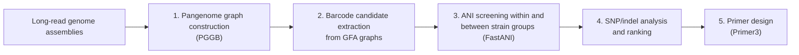

# PanBarcode

A pangenome graph pipeline for finding diagnostic DNA barcodes that distinguish closely related microbial strain groups.

https://github.com/user-attachments/assets/781d3ed9-1511-4128-95cf-21c259434d3a

**Website:** [choprakritika.github.io/PanBarcode](https://choprakritika.github.io/PanBarcode/) (explainer video, barcode playground, case study, and barcode library)

## Overview

Closely related strain groups are hard to tell apart with standard markers. PanBarcode builds pangenome graphs from long-read genome assemblies, finds conserved nodes shared by all genomes, and takes the variable regions between them as candidate barcodes. Candidates are screened by average nucleotide identity so they separate predefined strain groups, then ranked by SNP and indel differences. Each barcode is given PCR primers designed in the conserved flanking regions.

## Workflow

1. Pangenome graph construction (PGGB)
2. Barcode candidate extraction from GFA graphs
3. ANI screening within and between strain groups (FastANI)
4. SNP/indel analysis and ranking
5. Primer design (Primer3)

## Results so far

- Scaled from a 12-genome prototype to 97 *Fusarium oxysporum* genomes, and applied to f. sp. *lactucae*.
- Screened more than 2 million barcode candidates. Parallelizing on HTCondor (UW-Madison CHTC and the Open Science Pool) cut the largest run from an estimated 3-4 weeks to about 2 days.
- Narrowed about 750 candidates to the 24 most discriminating barcodes across 97 genomes.
- Barcodes are candidates; PCR validation has not been done yet.

## Tools

PGGB, Python, Bash, FastANI, Primer3, HTCondor

## Presented at

MemPanG 2026 (talk), Memphis, TN

## Code availability

The PanBarcode code will be released publicly alongside the manuscript. For questions or early access, contact [kritika.chopra@wisc.edu](mailto:kritika.chopra@wisc.edu).

## Author

Kritika Chopra, Department of Plant Pathology, University of Wisconsin-Madison
