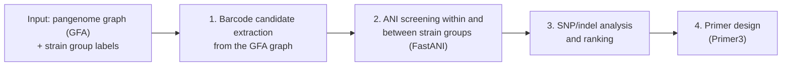

# PanBarcode

A pangenome graph pipeline for finding diagnostic DNA barcodes that distinguish closely related microbial strain groups.

https://github.com/user-attachments/assets/1956a995-f6eb-4d59-a75f-120104477bbc

## Website

[choprakritika.github.io/PanBarcode](https://choprakritika.github.io/PanBarcode/) has the explainer video, barcode playground, case study, and barcode library.

## Overview

Closely related strain groups are hard to tell apart with standard markers. PanBarcode takes as input a pangenome graph built from long-read genome assemblies, finds conserved nodes shared by all genomes, and takes the variable regions between them as candidate barcodes. Candidates are screened by average nucleotide identity so they separate predefined strain groups, then ranked by SNP and indel differences. Each barcode is given PCR primers designed in the conserved flanking regions.

## Workflow

**Input:** a pangenome graph in GFA format, built beforehand from long-read genome assemblies (for example with PGGB), and the strain group labels.

1. Barcode candidate extraction from the GFA graph
2. ANI screening within and between strain groups (FastANI)
3. SNP/indel analysis and ranking
4. Primer design (Primer3)

## Code availability

The PanBarcode code will be released publicly alongside the manuscript. For questions or early access, contact [kritika.chopra@wisc.edu](mailto:kritika.chopra@wisc.edu).

## Author

Kritika Chopra, Department of Plant Pathology, University of Wisconsin-Madison
